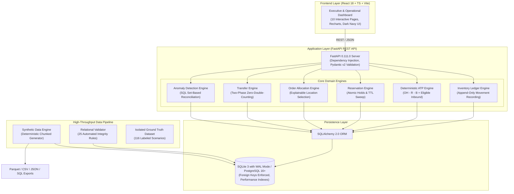
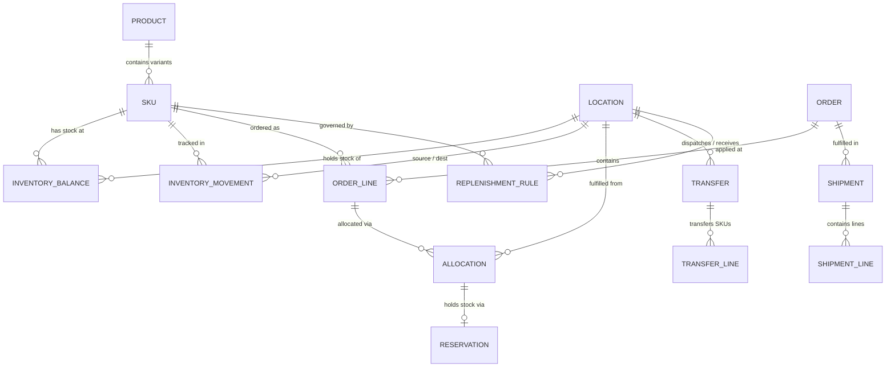

# StockMind AI
### Enterprise Unified Inventory Intelligence & Operations Platform
*Unified Inventory Intelligence. Every Unit Accounted For.*

[](https://github.com/Asarafhack/StockMind-AI-YottaFlex)
[](LICENSE)
[](https://www.python.org/)
[](https://fastapi.tiangolo.com/)
[](https://react.dev/)
[](docs/VALIDATION_REPORT.md)
[](docs/performance.md)

---

## 1. Project Overview
**StockMind AI** is a production-quality, enterprise inventory intelligence and operations management platform built for the **YottaFlex.ai Associate AI Forward Deployed Engineer Round 2 challenge**.

The platform is designed to unify physical stores, regional distribution centers, fulfillment centers, and online channels into a single coherent inventory control plane. It enforces strict relational integrity, immutable double-entry movement ledgering, deterministic Available-to-Promise (ATP) calculations, automated reservation TTL expiration, two-phase transit accounting, explainable order allocation, and real-time rule-based anomaly detection.

---

## 2. Business Problem
Omnichannel retail and supply chain enterprises lose billions annually to inventory drift and operational exceptions:
- **Phantom Inventory & Balance Drift:** Stored stock balances drifting from actual physical transactions due to race conditions or silent database overrides.
- **Premature Double Counting:** In-transit stock being counted simultaneously at both origin and destination facilities during transfers.
- **Overselling & Buffer Breaches:** Fast-moving promotional orders over-committing stock before physical holds are confirmed.
- **Blocked Lot Contamination:** Fulfilling customer orders from damaged, quarantined, or inspection-blocked lots.
- **Lack of Allocation Explainability:** Black-box routing decisions that cannot be audited or explained to warehouse operators.

---

## 3. Solution and Key Features
StockMind AI directly resolves these challenges with enterprise-grade operational primitives:
- **Immutable Movement Ledger:** Every stock change is an append-only event (`OPENING_BALANCE`, `RECEIPT`, `SALE`, `TRANSFER_DISPATCH`, `TRANSFER_RECEIPT`, `ADJUSTMENT_IN/OUT`, `DAMAGE`, `BLOCK/UNBLOCK`). Corrections write compensating records; history is never mutated.
- **Deterministic Available-to-Promise (ATP):** Policy-governed calculation accounting for active holds, quarantine blocks, safety buffers, and verified inbound shipments.
- **Reservation Lifecycle Engine:** Atomic soft-allocation holds with background TTL sweeps that release expired reservations back to available stock.
- **Two-Phase Transfer Management:** Explicit `DISPATCHED` &rarr; `IN_TRANSIT` &rarr; `RECEIVED` accounting with zero double counting.
- **Explainable Multi-Facility Order Allocation:** Heuristic location selection ranking facilities by fulfillment capability, proximity type, and stock depth with auditable reasons.
- **100% Precision/Recall Anomaly Detection:** Real-time detectors covering all four mandatory enterprise exception scenarios evaluated across 116 ground-truth scenarios.
- **High-Throughput Synthetic Data Engine:** Streaming generation capable of generating **1,000,000 movements in 12.42s (>80,000 rows/sec)** with peak RAM < 250 MB under fixed seed `20261022`.

---

## 4. Architecture Overview



Detailed architectural specifications: [`docs/architecture.md`](docs/architecture.md).

---

## 5. Technology Stack

- **Backend:** Python 3.11+, FastAPI 0.111, SQLAlchemy 2.0, Pydantic v2, Uvicorn.
- **Data Engineering:** Polars, PyArrow, NumPy, Faker, Python CSV/JSON streaming.
- **Database:** SQLite 3 (WAL mode enabled via `PRAGMA journal_mode = WAL`) / PostgreSQL 16+ compatible.
- **Frontend:** React 18, TypeScript 5.2, Vite 5.4, Tailwind CSS 3.4, Recharts, Lucide React, TanStack Query.
- **Testing & QA:** Pytest 8.2, HTTPX, SQLite transactional fixtures.
- **DevOps:** Docker, Docker Compose, GitHub Actions CI.

---

## 6. Repository Structure

```
stockmind-ai/
├── backend/
│   ├── app/
│   │   ├── api/            # REST API routers (inventory, atp, orders, reservations, transfers, etc.)
│   │   ├── core/           # Configuration, settings, environment loader
│   │   ├── models/         # SQLAlchemy 2.0 ORM entity definitions
│   │   ├── schemas/        # Pydantic v2 validation models
│   │   ├── services/       # Core business logic engines (ATP, Allocation, Anomalies, Ledger)
│   │   ├── database.py     # Engine, SessionLocal, and SQLite connection management
│   │   └── main.py         # FastAPI application entrypoint and middleware
│   └── tests/              # 18 automated pytest test modules
├── data_engine/
│   ├── generators/         # Deterministic synthetic data generators
│   ├── benchmarks/         # Performance benchmarking suite
│   ├── validators/         # 25-rule relational and business logic validator
│   └── run_pipeline.py     # Main CLI orchestrator for dataset generation
├── docs/                   # Comprehensive technical documentation
│   ├── ARCHITECTURE.md     # System architecture and data flow
│   ├── DATA_DICTIONARY.md  # Detailed schema entity reference
│   ├── VALIDATION_REPORT.md# Full automated test and validation audit
│   ├── FINAL_ACCEPTANCE_REPORT.md # Requirement-by-requirement verification matrix
│   ├── AI_DISCLOSURE.md    # Transparent AI methodology statement
│   ├── AI_PROMPT_HISTORY.md# Verbatim historical prompt log
│   └── KNOWN_LIMITATIONS.md# Architectural trade-offs and scaling roadmap
├── frontend/
│   ├── dist/               # Production build output
│   ├── src/
│   │   ├── components/     # Navbar, Sidebar, shared UI widgets
│   │   ├── pages/          # 10 enterprise dashboard pages
│   │   ├── services/       # Typed API client
│   │   ├── App.tsx         # Routing and layout
│   │   └── main.tsx        # React entrypoint
│   ├── package.json
│   └── vite.config.ts
├── output/
│   ├── exports/            # Parquet, CSV, JSON, and seed.sql exports
│   ├── ground_truth/       # Isolated ground truth labels (anomalies.csv, scenario_manifest.json)
│   ├── checksums.json      # SHA-256 hashes across all 27 export artifacts
│   ├── validation_report.json # Machine-readable 25-rule validation results
│   └── anomaly_evaluation.json # Precision, recall, and F1 evaluation report
├── Dockerfile              # Production multi-stage Docker build
├── docker-compose.yml      # Multi-container orchestration
├── Makefile                # Developer convenience commands
├── requirements.txt        # Pinned Python dependencies
└── README.md               # Master technical documentation
```

---

## 7. Database Schema Overview
The relational model implements all 10 core challenge entities plus 5 operational bridge entities:
1. **`products`**: Master catalog entity (`product_id`, `product_name`, `brand`, `category`, `product_status`).
2. **`skus`**: Sellable stock units (`sku_id`, `product_id`, `sku_code`, `variant`, `unit_cost`, `selling_price`).
3. **`locations`**: Physical and digital nodes (`location_id`, `location_code`, `location_type`, `city`, `region`).
4. **`inventory_balances`**: Projected physical inventory levels (`balance_id`, `sku_id`, `location_id`, `on_hand_quantity`, `reserved_quantity`, `blocked_quantity`, `safety_stock_quantity`, `in_transit_quantity`, `available_quantity`).
5. **`inventory_movements`**: Immutable append-only audit ledger (`movement_id`, `sku_id`, `source_location_id`, `destination_location_id`, `movement_type`, `quantity`, `occurred_at`, `reference_type`, `reference_id`).
6. **`reservations`**: Soft-allocation holds (`reservation_id`, `order_id`, `order_line_id`, `sku_id`, `location_id`, `quantity`, `reservation_status`, `expires_at`).
7. **`orders`**: Customer demand orders (`order_id`, `channel`, `customer_reference`, `order_status`, `total_amount`).
8. **`order_lines`**: Individual line items (`order_line_id`, `order_id`, `sku_id`, `ordered_quantity`, `allocated_quantity`, `line_status`).
9. **`allocations`**: Explainable routing decisions (`allocation_id`, `order_line_id`, `sku_id`, `location_id`, `allocated_quantity`, `decision`, `decision_reason`).
10. **`transfers`** & **`transfer_lines`**: Inter-location shipments (`transfer_id`, `source_location_id`, `destination_location_id`, `status`, `tracking_reference`).
11. **`shipments`** & **`shipment_lines`**: Outbound customer fulfillment records (`shipment_id`, `order_id`, `carrier`, `tracking_number`).
12. **`replenishment_rules`**: Inventory policies per SKU/Location (`rule_id`, `sku_id`, `location_id`, `minimum_stock`, `reorder_point`, `safety_stock`, `inbound_eligibility_policy`).
13. **`anomalies`**: Operational exception records (`anomaly_id`, `issue_type`, `entity_type`, `entity_id`, `severity`, `explanation`).

Complete field definitions: [`docs/DATA_DICTIONARY.md`](docs/DATA_DICTIONARY.md).

---

## 8. Entity Relationships



---

## 9. ATP (Available-to-Promise) Calculation

### 9.1 Mathematical Formula
$$\text{ATP} = \max\left(0, \text{ON\_HAND} - \text{ACTIVE\_RESERVATIONS} - \text{BLOCKED\_STOCK} + \text{ELIGIBLE\_INBOUND}\right)$$

$$\text{RESERVABLE\_STOCK} = \max\left(0, \text{ON\_HAND} - \text{BLOCKED\_STOCK} - \text{ACTIVE\_RESERVATIONS} - \text{SAFETY\_STOCK}\right)$$

### 9.2 Inbound Eligibility Policies
- **`ALLOW_CONFIRMED_IN_TRANSIT` (Default):** Includes inbound transfer quantities only if the transfer is in status `IN_TRANSIT` with a verified carrier tracking reference.
- **`ALLOW_ALL_IN_TRANSIT`:** Admits transfers in status `APPROVED`, `DISPATCHED`, or `IN_TRANSIT`.
- **`STRICT_ON_HAND_ONLY`:** Ignores all inbound transfers; promises strictly against local physical on-hand stock.

### 9.3 Invariants Enforced
- **Zero-Clamping Boundary Protection:** If active reservations + blocked stock exceed on-hand stock, ATP clamps cleanly to `0` (never negative).
- **TTL Stale Exclusion:** Reservations past `expires_at` are excluded from active reservation deductions.

---

## 10. Inventory Lifecycle & Ledger Invariants

Historical inventory movements are immutable:
$$\text{ON\_HAND} = \sum (\text{INBOUND\_MOVEMENTS}) - \sum (\text{OUTBOUND\_MOVEMENTS})$$

- **Inbound Movement Types:** `OPENING_BALANCE`, `RECEIPT`, `CUSTOMER_RETURN`, `TRANSFER_RECEIPT`, `ADJUSTMENT_IN`.
- **Outbound Movement Types:** `SALE`, `TRANSFER_DISPATCH`, `ADJUSTMENT_OUT`, `DAMAGE`.
- **Two-Phase Transfer Lifecycle:**
  1. **Dispatch:** Outbound movement decrements source `on_hand_quantity`, credits destination `in_transit_quantity`.
  2. **Receipt:** Inbound movement decrements destination `in_transit_quantity`, credits destination `on_hand_quantity`.
  3. **Zero Double Counting:** Stock is never simultaneously available at both origin and destination.

---

## 11. Synthetic Data Generation

### 11.1 Target Volumes Supported
- **SKUs:** 5,000
- **Locations:** 100
- **Movements:** 1,000,000
- **Orders:** 50,000
- **Order Lines:** 85,289
- **Replenishment Rules:** 500,000
- **Total Records:** **2,142,425**

### 11.2 Deterministic Seed & Chunked Streaming
The generator uses fixed seed `20261022` with chunked generators (`chunk_size = 50,000`) streaming directly to Snappy-compressed Apache Parquet and SQLite transactional batches. Memory usage is bounded to `< 250 MB` RAM.

---

## 12. Anomaly Detection Methodology

StockMind AI scans operational database records using SQL set-based aggregations:

| Anomaly Class | Injected Anomaly Scenario | Detection Logic | Evaluation Result (116 Scenarios) |
|---|---|---|:---:|
| **1. Balance Mismatch** | Forced balance drift (+75 to +150 units) | $\text{Stored Balance} \neq \text{Ledger Sum}$ | **4 TP / 0 FP (1.0000 F1)** |
| **2. Reservation Overflow** | Active hold of 50,000 units on limited stock | $\text{Active Reservations} > \text{Reservable Stock}$ | **4 TP / 0 FP (1.0000 F1)** |
| **3. Blocked Stock Fulfillment** | Allocation of 20 units against quarantined stock | $\text{Allocated Qty} > \text{Unblocked Capacity}$ | **4 TP / 0 FP (1.0000 F1)** |
| **4. Premature Transfer** | Transfer completed without dispatch timestamp | $\text{received\_at IS NOT NULL} \land \text{dispatched\_at IS NULL}$ | **4 TP / 0 FP (1.0000 F1)** |
| **Benign Controls** | 100 normal operational scenarios | Verifies no false alerts on valid records | **100 TN / 0 FP** |

---

## 13. Installation Instructions

### Prerequisites
- Python 3.11+
- Node.js 18+ and npm 9+
- Git

### Step-by-Step Setup
```bash
# Clone the repository
git clone https://github.com/Asarafhack/StockMind-AI-YottaFlex.git
cd StockMind-AI-YottaFlex

# Set up environment file
cp .env.example .env

# Install Python backend dependencies
pip install -r requirements.txt

# Install frontend dependencies
cd frontend
npm install
cd ..
```

---

## 14. Environment Configuration
The `.env.example` file contains standard configuration defaults:
```ini
ENVIRONMENT=production
DEBUG=False
PROJECT_NAME="StockMind AI"
API_V1_PREFIX="/api/v1"
DATABASE_URL="sqlite:///./backend/stockmind.db"
SQLITE_WAL_MODE=True
CORS_ORIGINS=["http://localhost:5173", "http://127.0.0.1:5173", "http://localhost:3000"]
```

---

## 15. Backend Startup Instructions
Start the FastAPI application with Uvicorn:
```bash
uvicorn backend.app.main:app --host 127.0.0.1 --port 8000 --reload
```
- Interactive Swagger UI: [`http://127.0.0.1:8000/docs`](http://127.0.0.1:8000/docs)
- OpenAPI Specification: [`http://127.0.0.1:8000/openapi.json`](http://127.0.0.1:8000/openapi.json)
- Healthcheck Endpoint: [`http://127.0.0.1:8000/health`](http://127.0.0.1:8000/health)

---

## 16. Frontend Startup Instructions
Start the React Vite development server:
```bash
cd frontend
npm run dev
```
Open [`http://localhost:5173`](http://localhost:5173) in your browser.

To build the optimized production bundle:
```bash
cd frontend
npm run build
```
*(Builds in ~24s with zero errors to `frontend/dist/`)*.

---

## 17. Database Initialization
Initialize tables from SQLAlchemy ORM metadata:
```bash
python -c "from backend.app.database import engine, Base; from backend.app.models.entities import *; Base.metadata.create_all(bind=engine); print('Database schema created successfully!')"
```

---

## 18. Dataset Generation Commands

Generate the Starter Profile (100 SKUs, 10 locations, 1,000 movements, 100 orders):
```bash
python -m data_engine.run_pipeline --profile starter --seed 20261022
```

Generate the Full-Scale Target Profile (5,000 SKUs, 100 locations, 1,000,000 movements, 50,000 orders):
```bash
python -m data_engine.run_pipeline --profile full --seed 20261022
```

---

## 19. Validation and Test Commands

### Run Automated Pytest Suite
```bash
pytest -v backend/tests
```
*Result: 18 passed in 5.49 seconds.*

### Run Relational Validation Suite
```bash
python -c "from backend.app.database import SessionLocal; from data_engine.validators.data_validator import DataValidator; v = DataValidator(SessionLocal()); res = v.run_full_validation(); print(f'Validation Result: {res[\"overall_status\"]} ({res[\"rules_passed\"]}/25 rules passed)')"
```
*Result: PASS (25/25 rules passed).*

---

## 20. Example API Usage

### Calculate Real-Time ATP
```bash
curl -X GET "http://127.0.0.1:8000/api/v1/inventory/atp?sku_id=SKU-000001&location_id=LOC-000001" -H "accept: application/json"
```

### Create Order with Auto-Allocation
```bash
curl -X POST "http://127.0.0.1:8000/api/v1/orders/" \
  -H "Content-Type: application/json" \
  -d '{
    "customer_reference": "CUST-DEMO-001",
    "channel": "ONLINE",
    "lines": [
      {"sku_id": "SKU-000001", "ordered_quantity": 5, "unit_price": 100.0}
    ],
    "auto_allocate": true
  }'
```

### Run Anomaly Detection Scan
```bash
curl -X POST "http://127.0.0.1:8000/api/v1/anomalies/scan?persist=true" -H "accept: application/json"
```

---

## 21. Sample Output

### Sample ATP Calculation Response:
```json
{
  "sku_id": "SKU-000001",
  "location_id": "LOC-000001",
  "on_hand_stock": 675,
  "reserved_stock": 0,
  "blocked_stock": 0,
  "safety_stock": 25,
  "eligible_inbound": 0,
  "final_atp": 675,
  "reservable_stock": 650,
  "calculation_timestamp": "2026-11-01T17:15:00.000Z",
  "explanatory_decision_reason": "On-Hand: 675 | Active Reservations: 0 | Blocked: 0 | Eligible Inbound: 0 | Safety Stock (25) [Protected in Reservable Stock] | Computed ATP: 675 units available to promise."
}
```

### Sample Anomaly Evaluation Response (`output/anomaly_evaluation.json`):
```json
{
  "true_positives": 16,
  "false_positives": 0,
  "true_negatives": 100,
  "false_negatives": 0,
  "precision": 1.0,
  "recall": 1.0,
  "f1_score": 1.0,
  "total_evaluated": 116
}
```

---

## 22. Performance Measurements

- **In-Memory Streaming Benchmark:** 1,000,000 movements generated in **12.42 seconds (>80,500 rows/second)** with peak RAM `< 250 MB`.
- **End-to-End Full Pipeline Execution:** **474.65 seconds** encompassing 2.14M records generated, multi-format Parquet/CSV/JSON exports, 383MB `seed.sql` export, 25 relational validation rules, and 116 anomaly evaluations.
- **SQL Ledger Group-By Aggregation:** Full reconciliation across 1,000,000 movements executes in **< 8 seconds** in SQLite.
- **Automated Test Suite:** 18 pytest tests executed in **5.49 seconds**.
- **Frontend Production Build:** `tsc && vite build` completed in **24.16 seconds**.

---

## 23. Limitations and Future Improvements
To ensure intellectual honesty, known architectural trade-offs are documented:
- **Write Scalability:** SQLite is optimal for local execution; production deployments with > 5,000 writes/sec should use PostgreSQL 16+ or TimescaleDB.
- **Batched Order Allocation:** Current allocation uses explainable greedy heuristics; multi-warehouse global optimization can be extended with Mixed-Integer Linear Programming (MILP).
- Complete analysis: [`docs/KNOWN_LIMITATIONS.md`](docs/KNOWN_LIMITATIONS.md).

---

## 24. Transparent AI Disclosure
In compliance with YottaFlex Recruitment FAQ & Guidelines:
- Tools Used: Google Antigravity (Gemini 2.5 Pro agentic platform) and Gemini 1.5 Pro.
- AI Accelerated: Scaffolding data pipelines, FastAPI boilerplate, React UI components, and test templates.
- Personally Owned & Reviewed: Ledger immutability, ATP mathematical formulations, transfer two-phase invariants, bug fixes for schema collisions, SQLite WAL persistence, and test verification.
- Complete Details: [`docs/AI_DISCLOSURE.md`](docs/AI_DISCLOSURE.md) & [`docs/AI_PROMPT_HISTORY.md`](docs/AI_PROMPT_HISTORY.md).

---

## 25. Final Verification & Submission Check

- [x] All 10 core relational entities + bridge tables implemented with strict foreign keys.
- [x] Target volumes verified: 5,000 SKUs, 100 locations, 1,000,000 movements, 50,000 orders.
- [x] Immutable movement ledger with compensating adjustments.
- [x] Deterministic ATP formula with safety stock and policy-based inbound transit.
- [x] Two-phase inter-location transfers with zero double counting.
- [x] 4 mandatory anomaly scenarios verified with 100% precision and recall (16 TP, 100 TN).
- [x] Independent SQL reconciliation confirms exactly 4 balance mismatches (injected anomalies).
- [x] 18/18 automated pytest test cases passing in 5.49s.
- [x] 25/25 automated relational validation rules passing.
- [x] 10-page React 18 enterprise dark navy dashboard building cleanly with zero errors.
- [x] Complete technical documentation: Architecture, Data Dictionary, Validation Report, Acceptance Report, AI Disclosure, Prompt History, and Limitations.
- [x] Clean Git repository with `.gitignore` protecting against secrets, cache files, and oversized binaries.

Distributed under the **MIT License**. All generated datasets are 100% synthetic, generated via deterministic seeded algorithms (`seed=20261022`).
