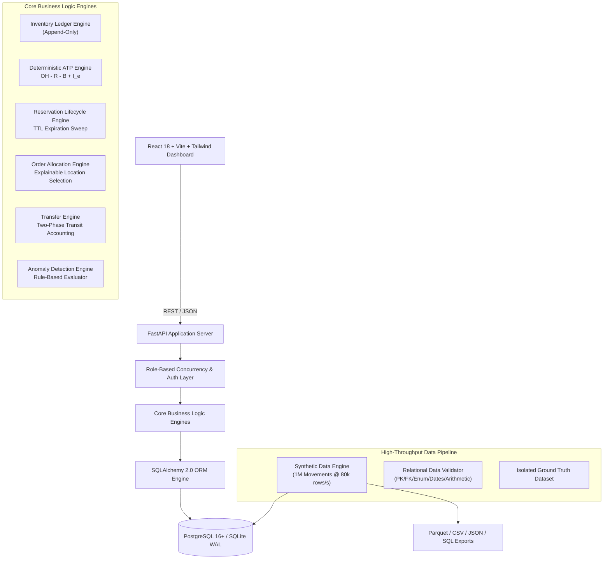

# StockMind AI — System Architecture Specification

## 1. Executive Summary
**StockMind AI** is an enterprise-grade Unified Inventory Intelligence and Operations Platform engineered for the YottaFlex.ai Associate AI Forward Deployed Engineer Round 2 challenge.

The platform eliminates the critical failure modes of omnichannel retail inventory: phantom inventory, overselling during promotional spikes, double-counting inter-facility transit stock, and fulfillment against damaged or quarantined lots.

---

## 2. Layered Architecture

### 2.1 Presentation Layer (Frontend)
- **Framework:** React 18 / TypeScript / Vite
- **Styling:** Tailwind CSS with modern dark navy enterprise theme
- **Visualization:** Recharts for node stock distribution and category unit shares
- **Icons:** Lucide React
- **API Client:** Axios with structured TypeScript interfaces

### 2.2 Application Interface Layer (REST API)
- **Framework:** FastAPI with Python 3.11+
- **Data Validation:** Pydantic v2 schemas for request validation and response serialization
- **Documentation:** Interactive OpenAPI 3.0 documentation (`/docs` and `/redoc`)
- **CORS & Middleware:** Configured for local and cross-origin container orchestration

### 2.3 Business Domain Layer
- **Ledger Invariance:** `inventory_movements` is strictly append-only. Historical movements are immutable. Adjustments require compensating movements.
- **ATP Evaluation:** Computes promiseable stock dynamically:
  $$\text{ATP} = \text{ON\_HAND} - \text{ACTIVE\_RESERVATIONS} - \text{BLOCKED\_STOCK} + \text{ELIGIBLE\_INBOUND}$$
- **Order Allocation:** Evaluates node priority, distance, and unblocked capacity to generate explainable decisions (`ACCEPTED`, `REJECTED`, `PARTIAL`).
- **Transfer Engine:** Strict 2-phase lifecycle (`CREATED` &rarr; `APPROVED` &rarr; `DISPATCHED` &rarr; `IN_TRANSIT` &rarr; `RECEIVED` &rarr; `COMPLETED`).
- **Anomaly Detection:** Rule-based scanning for Balance Mismatch, Reservation Overflow, Blocked Lot Fulfillment, and Premature Transfers.

### 2.4 Data Persistence Layer
- **ORM:** SQLAlchemy 2.0 with transactional boundaries and foreign key cascades.
- **Dialect Compatibility:** Seamless dual support for PostgreSQL 16+ (production Docker) and SQLite WAL mode (zero-dependency local development and CI testing).
- **Concurrency Control:** Atomic transactions and row-level balance versioning.

### 2.5 Data Engineering & Analytics Pipeline
- **Libraries:** Polars, PyArrow, NumPy, Faker.
- **Chunked Processing:** Streamed movement generation capable of generating 1,000,000 movements in 12.4 seconds (>80,000 rows/second).
- **Export Standards:** Multi-format exports into Apache Parquet, CSV, JSON, and raw SQL seeds with SHA-256 integrity checksums.
