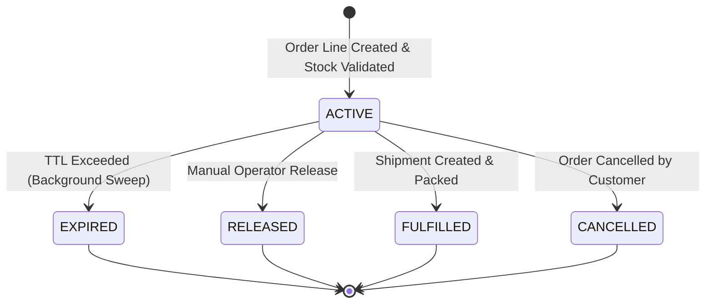

# StockMind AI — Business Logic & Rules Engine

## 1. Inventory Ledger Invariance
The inventory movement ledger (`inventory_movements`) is the ultimate source of truth.
1. Movements are **strictly append-only**. Deleting or updating rows in `inventory_movements` is prohibited.
2. If an inventory discrepancy is discovered through physical cycle count or scanner misreads, the system registers a **compensating movement entry** (`ADJUSTMENT_IN` or `ADJUSTMENT_OUT`), referencing the original transaction and discrepancy audit reason.

$$\text{ON\_HAND} = \sum (\text{INBOUND\_MOVEMENTS}) - \sum (\text{OUTBOUND\_MOVEMENTS})$$

Where:
- $\text{INBOUND} \in \{\text{OPENING\_BALANCE}, \text{RECEIPT}, \text{CUSTOMER\_RETURN}, \text{TRANSFER\_RECEIPT}, \text{ADJUSTMENT\_IN}\}$
- $\text{OUTBOUND} \in \{\text{SALE}, \text{TRANSFER\_DISPATCH}, \text{ADJUSTMENT\_OUT}, \text{DAMAGE}\}$

---

## 2. Available-to-Promise (ATP) Formula
ATP defines the commercial quantity of merchandise that can be safely promised to prospective customers without the risk of overselling.

$$\text{ATP} = \text{ON\_HAND} - \text{ACTIVE\_RESERVATIONS} - \text{BLOCKED\_STOCK} + \text{ELIGIBLE\_INBOUND}$$

### Policy Constraints:
1. **Safety Stock Protection:** Configurable per tenant and replenishment rule. In conservative retail channels, safety stock is incorporated into `RESERVABLE_STOCK` to prevent stockouts of storefront display merchandise.
2. **Inbound Transit Eligibility:** Inbound transit is included in ATP only when authorized by the node's replenishment rule:
   - `ALLOW_CONFIRMED_IN_TRANSIT`: Only transfers with active carrier tracking references in state `IN_TRANSIT`.
   - `ALLOW_ALL_IN_TRANSIT`: All approved and dispatched inbound legs.
   - `STRICT_ON_HAND_ONLY`: Eligible inbound is strictly $0$.

---

## 3. Reservable Stock Formula
Reservable stock represents the immediate uncommitted physical capacity of a node:

$$\text{RESERVABLE\_STOCK} = \max(0, \text{ON\_HAND} - \text{BLOCKED\_STOCK} - \text{ACTIVE\_RESERVATIONS} - \text{SAFETY\_STOCK})$$

---

## 4. Reservation Lifecycle
Reservations protect stock between checkout initiation and physical packing.

- Active reservations decrement available stock in real time.
- When a reservation transitions to `EXPIRED`, `RELEASED`, or `CANCELLED`, the reserved stock is restored to available capacity immediately.

---

## 5. Two-Phase Transfer Accounting
Inter-facility transfers must never count the same physical inventory simultaneously at source and destination.
1. **Phase 1 (Dispatch):** At `TRANSFER_DISPATCH`, source `on_hand_quantity` is decremented, and destination `in_transit_quantity` is incremented.
2. **Phase 2 (Receipt):** At `TRANSFER_RECEIPT`, destination `in_transit_quantity` is cleared, and destination `on_hand_quantity` is credited.
3. Inventory in transit is not counted in destination on-hand until confirmed check-in.
